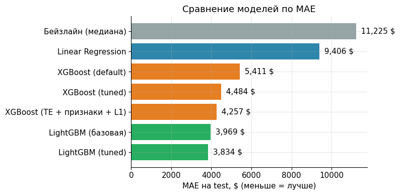

# Предсказание цены автомобиля

Ноутбук `cars_prediction.ipynb` учится предсказывать цену подержанного автомобиля по его характеристикам: марка, модель, год выпуска, пробег, объём двигателя, тип коробки передач и другим.

## Данные

Используется датасет с Kaggle — [Car Price Prediction Challenge](https://www.kaggle.com/datasets/deepcontractor/car-price-prediction-challenge): 19 237 объявлений, 18 колонок. Целевая переменная — `Price` в долларах.

## Целевая метрика

`MAE` - Наиболее интерпретируема, в одной размерности с таргетом. 

## Что делает ноутбук

1. **Очистка данных.** Приводит колонки к числовому виду (`Levy` с прочерками, `Mileage` со строкой "km", двери в формате "02-Mar"). Полные дубликаты объявлений оставляет: эксперимент с агрегацией по медианной цене ухудшал метрику.
2. **Разведочный анализ (EDA).** Смотрит распределения, пропуски, связь признаков с ценой, корреляции. Главный вывод: у цены сильный правый хвост, поэтому модели обучаются на `log1p(Price)`.
3. **Признаки.** Добавляет возраст авто, признак турбомотора, пробег в год, флаг премиальной марки, популярность модели и другие. Для высококардинальных `Model` (1590+ категорий) и `Manufacturer` применяет target encoding с OOF-расчётом (без утечки).
4. **Модели.** Обучает и сравнивает бейзлайн по медиане, линейную регрессию и градиентный бустинг. XGBoost — с подбором гиперпараметров через `RandomizedSearchCV`, финальная модель — LightGBM на нативных категориальных признаках с L1-лоссом (медианная регрессия: MAE минимизируется медианой, а медиана инвариантна к монотонным преобразованиям — обучение с абсолютной ошибкой на `log1p(Price)` даёт оценку медианы цены). Метрика — MAE на тестовой выборке в долларах.

## Результаты

| Модель | MAE (test), $ | R² (test) |
|---|---|---|
| Бейзлайн (медиана) | 11 225 | −0.066 |    
| Linear Regression | 9 406 | −0.070 |
| XGBoost (default) | 5 411 | 0.577 |
| XGBoost (tuned) | 4 484 | 0.717 |
| XGBoost (TE + признаки + L1) | 4 257 | 0.731 |
| LightGBM (базовая) | 3 969 | 0.752 |
| **LightGBM (tuned)** | **3 834** | **0.759** |

Лучшая модель — LightGBM с подобранными параметрами: средняя ошибка ≈ 3 800 $ (−15 % к tuned XGBoost).

